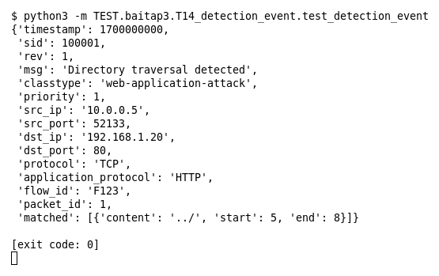

# T14 — Detection Event (Bài 3)

Chạy (từ thư mục gốc repo): `python3 -m TEST.baitap3.T14_detection_event.test_detection_event`

## Test gì

Test case **T14 Detection Event** ở mục 7 của đề. Kết quả mong đợi của đề: *Có đủ sid/msg/flow/5-tuple/protocol/match info.*

Ví dụ ở mục 5 của đề: rule 100001/1 "Directory traversal detected" (priority 1), event `10.0.0.5:52133 → 192.168.1.20:80 TCP`, HTTP, flow `F123`, payload chứa `../`.

## Input và output mong đợi

Input là file rule `input/detection_event.rules` (event dựng sẵn trong file test):

```
alert tcp any any -> 192.168.1.20 80 (msg:"Directory traversal detected"; content:"../"; classtype:web-application-attack; priority:1; sid:100001; rev:1;)
```

Output mong đợi:

| Hạng mục | Mong đợi |
|---|---|
| sid / rev | `(100001, 1)` |
| msg / priority | `('Directory traversal detected', 1)` |
| 5-tuple + protocol | `('10.0.0.5', 52133, '192.168.1.20', 80, 'TCP')` |
| application_protocol / flow_id | `('HTTP', 'F123')` |
| matched (content ../) | `[{'content': '../', 'start': 5, 'end': 8}]` |
| timestamp | `1700000000` |

## Kết quả chạy



Ngày chạy: 2026-10-25.

| Hạng mục | Output thật | Khớp |
|---|---|---|
| sid / rev | `(100001, 1)` | ✓ |
| msg / priority | `('Directory traversal detected', 1)` | ✓ |
| 5-tuple + protocol | `('10.0.0.5', 52133, '192.168.1.20', 80, 'TCP')` | ✓ |
| application_protocol / flow_id | `('HTTP', 'F123')` | ✓ |
| matched (content ../) | `[{'content': '../', 'start': 5, 'end': 8}]` | ✓ |
| timestamp | `1700000000` | ✓ |

**Kết luận:** 6/6 hạng mục đúng mong đợi, exit code 0 → **ĐẠT**.
