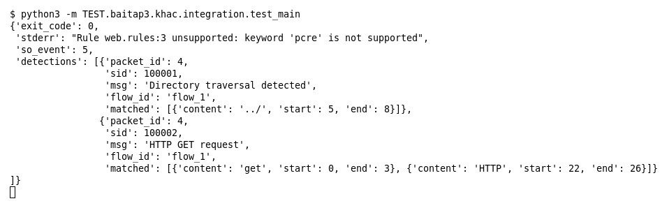

# Integration (Bài 3, ngoài danh sách của đề)

Chạy (từ thư mục gốc repo): `python3 -m TEST.baitap3.khac.integration.test_main`

## Test gì

Chạy `main.py` thật với `--rules`: PCAP → Parser → Decoder → Preprocessor → Flow Tracker → Core Engine → `detections.jsonl`.
PCAP gồm 5 gói: SYN, SYN/ACK, ACK, client gửi `GET /../../etc/passwd HTTP/1.1`, server trả `200 OK`.

## Input và output mong đợi

Input: PCAP dựng trong file test và `input/web.rules` (3 rule: `../`, `get` nocase + `HTTP`, một rule dùng `pcre`).

| Hạng mục | Mong đợi |
|---|---|
| `exit_code` | `0` |
| `stderr` | cảnh báo rule `pcre` là `unsupported` (dòng 3) |
| `so_event` | `5` |
| `detections` | gói 4 khớp sid `100001` và `100002`, cùng `flow_1`; gói 1–3 và 5 không có detection |

## Kết quả chạy

Ngày chạy: 2026-10-25.

| Hạng mục | Output thật | Khớp |
|---|---|---|
| `exit_code` | `0` | ✓ |
| `stderr` | `Rule web.rules:3 unsupported: keyword 'pcre' is not supported` | ✓ |
| `so_event` | `5` | ✓ |
| `detections` | gói 4: sid `100001` (`../` tại 5..8) và sid `100002` (`get` 0..3, `HTTP` 22..26), `flow_1` | ✓ |

**Kết luận:** 4/4 hạng mục đúng mong đợi, exit code 0 → **ĐẠT**.
